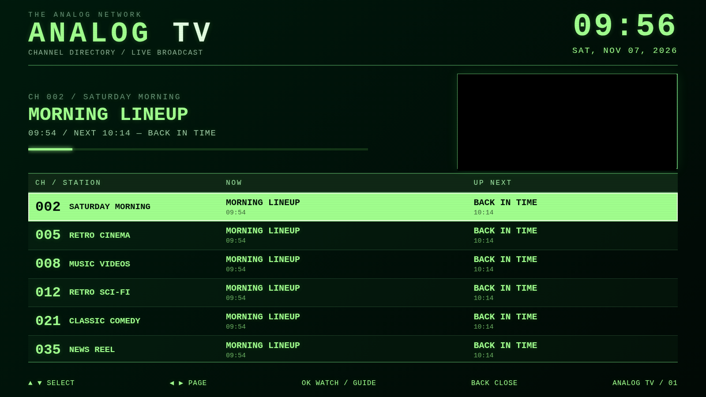
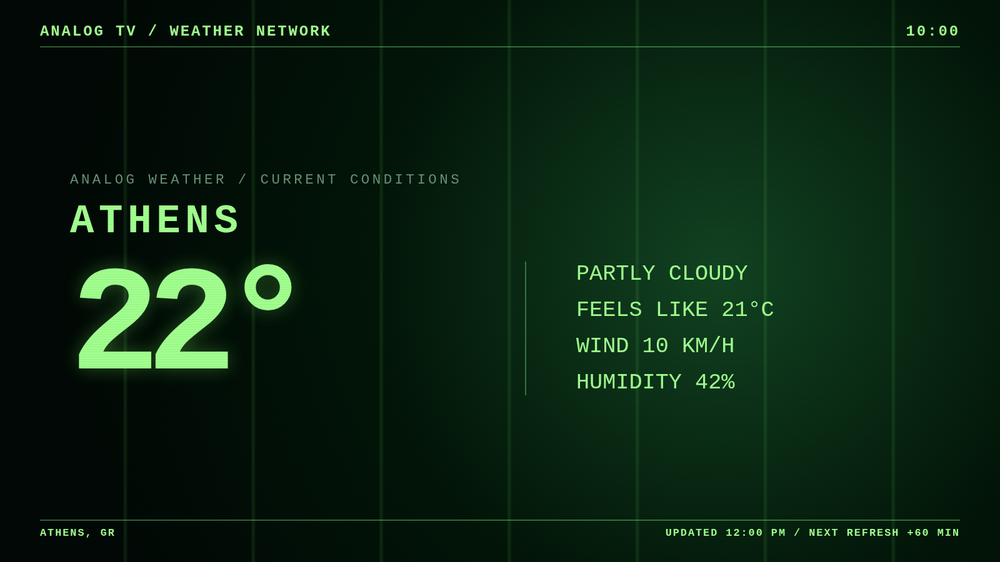

# Analog TV

> **Your own always-on television station.** A self-hosted, old-school TV experience with a green phosphor program guide, uninterrupted virtual broadcasting, dedicated weather television, IPTV channels, and a secure broadcast control room.



<p align="center"><strong>ANALOG TV · ON AIR · NO ALGORITHM, JUST TELEVISION</strong></p>

## What is Analog TV?

Analog TV transforms a collection of local video files and compatible streams into a continuously running television system. Every channel has its own broadcast clock: if you leave it and return later, you tune into what would be playing **right now**, rather than restarting the first file.

The full-screen player runs in a browser or the companion Android TV application. The server can run on Home Assistant OS, Docker, or a Linux/macOS host. A modern program guide wraps the experience in deliberately nostalgic green-on-black graphics.

## Features

| Feature | What it does |
| --- | --- |
| **Broadcast-clock channels** | Local playlists run continuously against a virtual clock, with shuffle and scheduling support where configured |
| **Retro channel guide** | Press OK or short `0` to see the clock, station list, NOW/NEXT information, program progress, and live preview |
| **IPTV M3U import** | Multi-station playlists become numbered channels; HLS manifests remain single live streams |
| **Analog Weather (24/7)** | Current conditions, hourly and multi-day outlooks, hourly data refresh; configure by city/postal code or approximate IP |
| **Alert broadcast** | Telegram alerts, news ticker, regional severe-weather warnings, and full-screen critical warnings |
| **YouTube subscriptions** | Optional official YouTube OAuth integration using YouTube Data API and YouTube IFrame player |
| **Pluto TV shortcuts** | Launch official Pluto TV channels through its own app/site; direct restreaming is not included |
| **Google-secured Admin** | Google OpenID Connect + PKCE, server-verified ID token, allowlisted email, CSRF protection and signed sessions |
| **Android TV + touch** | Native static, automatic reconnect, local server discovery, physical remote mappings, touch channel navigation, hidden service menu |



### The controls

| Interaction | Analog TV action |
| --- | --- |
| OK / short `0` | Open program guide; when an alert is visible, dismiss the alert |
| Up / Down or CH+ / CH- | Next/previous channel; navigate guide when open |
| Left / Right | Volume control, or move through guide pages |
| Type channel number | Direct tune, including two-digit channels like `10` and `90` |
| Back | Close guide or dismiss alert |
| Android long-press `0` or Menu | Open hidden maintenance menu |
| Touch left 30% / right 70% | Previous / next channel |
| Touch long-press ~700 ms | Open maintenance menu |

## System architecture

```text
                  ANALOG TV // BROADCAST CONTROL
                          HTTPS + Google OIDC
                                 |
                           /admin + APIs
                                 |
  Android TV / mobile    FastAPI server               Sources
  Chromium / CRT       ┌───────────────────┐   ┌───────────────────────┐
  ┌────────────────┐   │ SQLite channels   │   │ Local media / HDD      │
  │ Green guide    │---│ Virtual scheduler │---│ IPTV M3U / HLS         │
  │ TV playback    │   │ Alerts & feeds    │   │ YouTube / News         │
  │ Touch + remote │   │ Weather forecast  │---│ Open-Meteo / MeteoAlarm│
  └────────────────┘   └───────────────────┘   └───────────────────────┘
          Public playback routes (no Google login required)
```

**Privacy and security:** The TV needs to read its channels without asking viewers to authenticate. Broadcast Control is separate: all configuration, write operations and OAuth settings require the single authorized Google account. Read [Security](docs/SECURITY.md) before exposing any services publicly.

## Quick start: Home Assistant OS (recommended)

**Requirements:** Home Assistant OS on a supported `aarch64` or `amd64` machine, a network connection, and enough storage for your media. The app uses internal port `8080` and host port **8155**.

1. Copy the complete `home-assistant/analog_tv` folder into `/addons/analog_tv` on the Home Assistant host.
2. Go to **Settings → Apps → App store → Check for updates**. Install **Analog TV** (`2.1.0-ha.6`).
3. If migrating from an earlier installation, **stop the old app first** and copy your SQLite database following [Migration](docs/MIGRATION.md). Otherwise let Analog TV create a new one.
4. Start the new app. On your LAN, open `http://HOME_ASSISTANT_IP:8155/` for television playback.
5. To use Admin, configure Google OAuth in private `/addon_configs/local_analog_tv/auth.env` and expose Analog TV through a trusted HTTPS hostname (not the plain LAN IP), following [Google sign-in setup](docs/GOOGLE_OAUTH.md). Restart the app.
6. Browse to `https://YOUR_HOSTNAME/admin`, authenticate as your configured Google account, and configure channels and weather location.

Home Assistant persistence paths:

```text
HA host:       /addon_configs/local_analog_tv/analog_tv.db
HA container:  /config/analog_tv.db
Secrets file:  /addon_configs/local_analog_tv/auth.env
Media:         /media  and  /share
Player URL:    http://HOME_ASSISTANT_IP:8155/
```

**Important:** This is a **new Home Assistant app slug**. The previous app's database is not automatically reused; see the migration document. Do not uninstall the old app until your channels are confirmed on Analog TV.

## Quick start: Docker

```bash
git clone https://github.com/YOUR_USERNAME/analog-tv.git
cd analog-tv/server
cp .env.example .env
# Edit .env with database, Google OAuth and other local settings.
docker compose up -d --build
```

Then visit `http://localhost:8155/`. The port can be changed in `docker-compose.yml`. Admin remains locked until your Google OAuth settings are configured. For Google sign-in, use a **real HTTPS domain** or a `localhost` redirect for development. See [Google OAuth](docs/GOOGLE_OAUTH.md).

## Quick start: Python

Python **3.11+** is required. FFmpeg/ffprobe is recommended to measure durations for virtual broadcast channels.

```bash
cd server
python3 -m venv .venv
source .venv/bin/activate
pip install -r requirements.txt
cp .env.example .env
python -m analog_tv.main
```

Open `http://localhost:8080/` for the web player. `ANALOG_PORT` controls the standalone server's internal listening port.

## Secure Google Admin sign-in

Admin is **closed by default**. Supplying only a Google email is not enough: the server must verify Google's signed ID token, and therefore you must create a **Google Web OAuth 2.0 client** yourself. Never put a Google password or client secret into the repository.

At minimum configure the following in your **private** `.env` (standalone) or HA `/addon_configs/local_analog_tv/auth.env`:

```env
ANALOG_ADMIN_EMAIL=your-google-account@gmail.com
ANALOG_GOOGLE_CLIENT_ID=...apps.googleusercontent.com
ANALOG_GOOGLE_CLIENT_SECRET=...
ANALOG_GOOGLE_REDIRECT_URI=https://tv.example.com/auth/google/callback
ANALOG_PUBLIC_BASE_URL=https://tv.example.com
ANALOG_SESSION_SECRET=long-random-value
ANALOG_COOKIE_SECURE=true
```

Generate the signing secret with `python3 -c 'import secrets; print(secrets.token_urlsafe(48))'`. Register exactly the matching redirect in Google Cloud Console. The server validates Google ID token signature, audience, issuer, expiration, nonce, verified email and approved email address. Admin API write requests also require a CSRF header. The public TV player does **not** require a Google login.

Full walkthrough: [docs/GOOGLE_OAUTH.md](docs/GOOGLE_OAUTH.md).

## Programming your own television

In **Broadcast Control**:

1. Add a channel and choose local folder, M3U, YouTube subscriptions or an official Pluto TV link.
2. For an IPTV playlist, enter the **first channel number**; each station gets the next free number. The import refuses conflicts rather than creating a partial schedule.
3. Local media channels use virtual broadcast time to maintain ongoing programming. MP4/H.264/AAC offers the broadest Android TV WebView compatibility. MKV may need remux/transcode.
4. Enable Analog Weather by choosing a city/postal code or confirming approximate IP-based location. Create the channel (default **90**) and tune to it. Forecast information refreshes once each hour.
5. Optional news/weather tickers and Telegram alerts are configured separately in Admin.

For Pluto TV, Analog TV uses the **official** site/app launcher; embedding or retransmitting Pluto content requires permission and is not provided here.

## Android TV and mobile APK

Open `android/` in Android Studio and build an APK from **Build → Build APK(s)** or create a signed release. The application ID is `gr.analogtv.client` and the code lives in `AnalogTVActivity.java`.

The Android client can discover a server at `:8155`, remembers the selected server, draws its offline/no-signal static natively, and supports resume/network recovery. On touch devices, the left 30% is previous channel, the right 70% next, and holding opens the maintenance menu. The maintenance menu supports IP change, discovery, reload, cache clear, connection reset, app version, and reachability checks.

This source package is **not** a prebuilt APK. Compile and sign it in Android Studio.

## Repository layout

```text
analog-tv/
├── README.md
├── LICENSE
├── .gitignore
├── server/
│   ├── analog_tv/          # FastAPI application, player, routes and services
│   ├── tests/              # Unit and access-control tests
│   ├── requirements.txt
│   ├── .env.example
│   └── docker-compose.yml
├── home-assistant/
│   └── analog_tv/          # Local Home Assistant app, includes server source
├── android/                # Android Studio project
└── docs/
    ├── GOOGLE_OAUTH.md
    ├── MIGRATION.md
    ├── SECURITY.md
    └── screenshots/
```

## Development and tests

```bash
cd server
python -m pip install -r requirements.txt
python -m pytest -q
```

The GitHub Actions workflow runs Python tests. A passing Python test suite does **not** constitute an Android APK build or a Home Assistant runtime test. Always verify both on your devices before upgrading production channels.

## Roadmap (ideas, not yet implemented)

- XMLTV EPG ingestion with actual network schedules and timezone-aware programming.
- Analog TV **Station IDs**: generated retro ident cards before programs and weather forecasts.
- Parental controls and per-channel PINs for shared family devices.
- Scheduled "commercial breaks" using your own archival clips and interstitials.
- QR pairing for Android TV and tablet without manually entering an IP address.
- Broadcast diagnostics with last-seen ingest, buffering and per-channel uptime.

## Acknowledgments

Inspired by the feel of channel surfing and vintage television guides. Weather forecasts are provided by [Open-Meteo](https://open-meteo.com/); geo-location and weather-warning sources are optional third-party integrations. Product and service names (Google, YouTube, Home Assistant, Pluto TV) belong to their respective owners. Analog TV is not endorsed by them.

## License

MIT — see [LICENSE](LICENSE). Contributions and issues are welcome.
